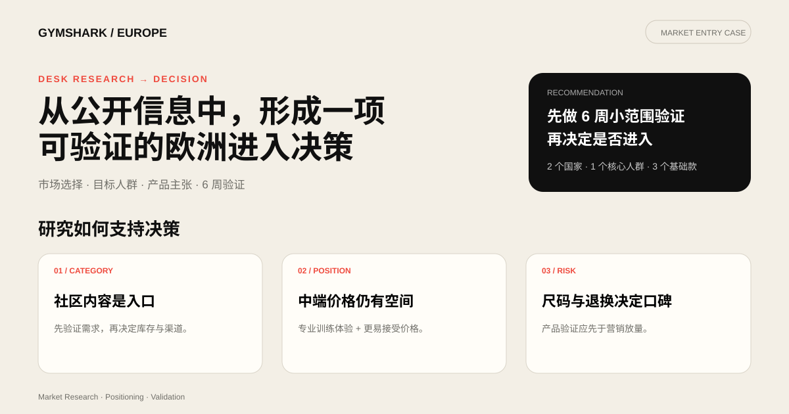

# Gymshark 欧洲市场研究：从公开证据到进入决策

> 作品集案例｜公开资料研究｜决策问题、证据等级与验证计划

## Dashboard 预览

> 点击预览图查看完整案例页面。

## 快速预览

- [决策案例页](case-study.html)：面向 HR 和业务负责人的一页式项目展示
- [欧洲市场进入决策简报](report/欧洲市场进入决策简报.md)：完整证据链与验证规则

## 项目要回答的问题

如果一家有成熟供应链、但在欧洲缺少品牌认知的中国健身服饰品牌准备进入欧洲，应该先进入哪里、服务谁、卖什么，以及用什么方式验证需求？

本项目用 Gymshark、Lululemon 和 Alphalete 作为参照系。目标是把公开资料转成一项可执行的市场进入决策。

## 决策建议

**建议采用“小范围验证后再进入”的路径。**

首轮验证聚焦德国与荷兰的 18–34 岁力量训练女性，主推 2–3 个可反复购买的训练基础款。渠道以本地微型创作者内容、独立站落地页和小预算付费放大组成；6 周后根据获客成本、落地页转化、退货原因和尺码反馈决定继续、调整或停止。

这项建议来自三类公开信号：

1. Gymshark 的公开发展路径说明社区内容、创作者分发和 DTC 可以形成低门槛进入组合。
2. 竞品价格带留下了“功能可信、价格低于高端专业品牌”的定位空间。
3. 公开评论反复出现尺码一致性、耐用性和售后摩擦，说明新进入者应把版型验证与退换体验放在传播之前。

以上是基于外部证据的商业假设，不代表品牌内部经营结论。完整判断、假设和否决条件见 [决策简报](report/欧洲市场进入决策简报.md)。

## 如何区分事实、推断和假设

| 标签 | 含义 | 可用于什么 |
|---|---|---|
| 已验证事实 | 能追溯到品牌官网、Companies House 或明确发布日期的公开材料 | 描述公司动作与市场背景 |
| 外部信号 | 评论、媒体、应用商店和第三方行业资料 | 发现问题方向，不能代表总体用户 |
| 分析推断 | 多个公开信号共同支持的解释 | 形成优先级 |
| 待验证假设 | 需要广告、访谈、样品或销售数据验证 | 设计实验与停止条件 |

雷达分数、痛点占比和部分竞品评分属于研究者编码，不能当成市场统计结果。原报告与图表保留用于展示信息整理和可视化能力，决策时应回到原始来源复核。

## 建议的 6 周验证

| 阶段 | 动作 | 核心指标 | 决策用途 |
|---|---|---|---|
| 第 1–2 周 | 8–12 位目标用户访谈、2 轮尺码试穿 | 版型问题、购买触发点、价格接受区间 | 修正人群与产品主张 |
| 第 2–4 周 | 3 套创意 × 2 个国家的落地页测试 | CTR、落地页转化、有效线索成本 | 判断信息与市场优先级 |
| 第 4–6 周 | 20–30 位微型创作者样品测试 | 可用内容率、互动质量、评论主题 | 判断内容供给和产品口碑 |
| 第 6 周 | 汇总实验结果 | CAC proxy、退货意向、尺码问题率 | Go / Iterate / Stop |

## 交付物

- [欧洲市场进入决策简报](report/欧洲市场进入决策简报.md)：明确决策、证据链、预算框架与停止条件
- [品牌深度研究报告](report/Gymshark品牌深度研究报告.md)：公开资料整理与竞品拆解
- [用户反馈分析](report/用户反馈分析.md)：公开评论主题编码
- `data/Gymshark竞品对比分析表.xlsx`：竞品资料表
- `charts/`：价格、品牌能力和评论主题的可视化
- `scripts/`：Excel、PPT 和图表生成脚本

## 数据边界

本项目没有 Gymshark 或竞品的内部销售、利润、投放、退货和用户级数据。公开评论存在自选择偏差；不同网站的价格与活动会随时间变化；第三方估算只能作为方向性信号。因此，本项目展示如何从不完整信息形成可检验的决策，不声称已经证明某一市场机会。

## 主要公开来源

Gymshark 官网及本地化站点、Companies House 财报、品牌与创始人公开材料、App Store / Google Play 评论、Trustpilot / Reddit 等公开用户讨论，以及报告内列出的行业媒体与第三方资料。所有时间敏感数据在真实决策前都应重新核验。
